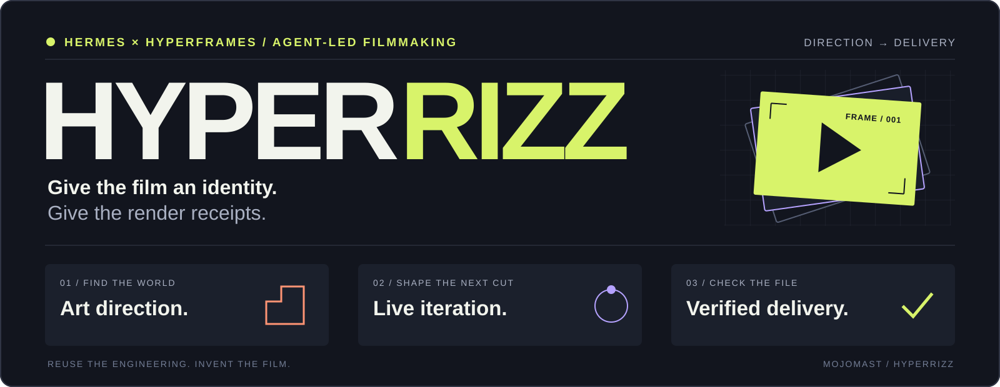
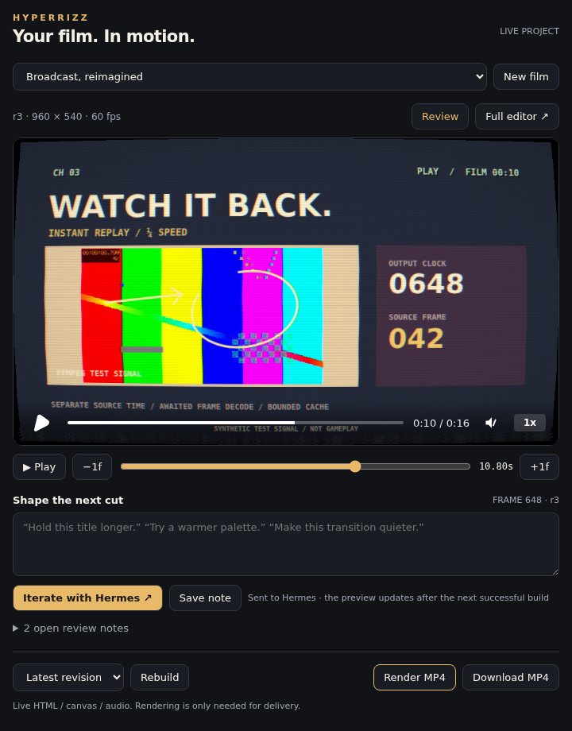
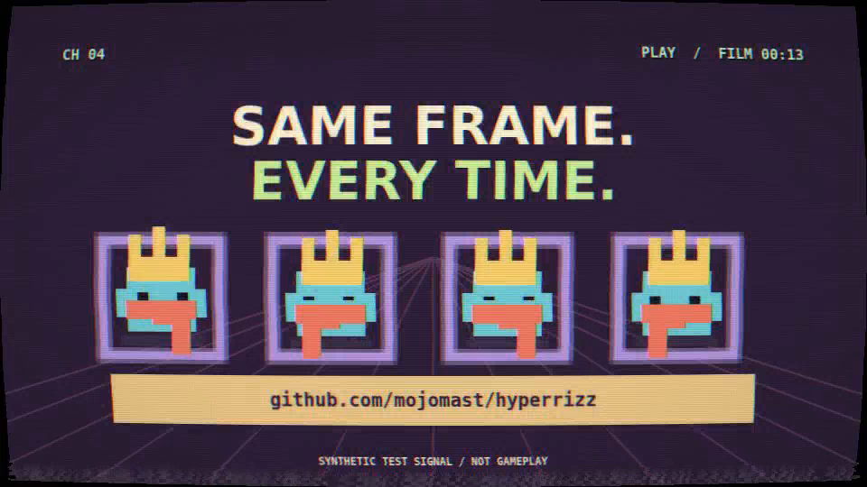

<p align="center">
  
</p>

<p align="center">
  <strong>Tell Hermes the story. Watch your film take shape.</strong><br>
  Agent-led production, a live review pane, frame-specific iteration, and the full HyperFrames editor when you want it.
</p>

<p align="center">
  <a href="https://github.com/mojomast/hyperrizz/actions/workflows/check.yml"></a>
  <a href="LICENSE"></a>
  <a href="docs/HERMES_PLUGIN.md"></a>
  <a href="https://hyperframes.heygen.com"></a>
  <a href="https://opencode.ai/v2/docs/skills"></a>
</p>

<p align="center">
  <a href="#install">Install</a> ·
  <a href="#put-it-to-work">Example prompts</a> ·
  <a href="#the-production-loop">Workflow</a> ·
  <a href="#run-the-starter">Starter</a> ·
  <a href="#what-is-actually-tested">Validation</a>
</p>

---

## Make something worth watching. Then prove it exported correctly.

Hyperrizz gives your coding agent a practical production discipline for
[HyperFrames](https://hyperframes.heygen.com): find the film's identity, build motion
around its meaning, preserve the truth of the source material, and finish with an
MP4 whose timing, picture, audio and file budget have been checked.

It grew out of four productions: a cartographer's field instrument, a virtual-pet
cable broadcast, a live-coding score sheet, and a warm architectural release film.
The skill carries forward their techniques **and their mistakes**.

**The core idea:** reuse the engineering; invent the film.

## A conversation, not a timeline assignment



*The shipping pane bundle in the SDK acceptance harness, with the real backend and
HyperFrames player. See [the verification scope](docs/HERMES_PLUGIN.md).*

**Hands-off first.** Hermes researches, art-directs, writes the scenes, builds,
checks and iterates. You can watch the actual project before spending time encoding
an MP4. Playback, sound, a scrubber and frame stepping are right there.

**Feedback with a location.** Pause on a moment, write what you want changed, and
hit **Iterate with Hermes**. The note carries the project, revision and exact frame
back into that conversation. The next successful build refreshes the live preview.

**Go deeper when you want.** **Full editor** opens the actual HyperFrames Studio
inside the pane: timeline, assets, code, layers and inspector. Click, drag, type and
paste. **Keep edits & review** checkpoints your changes. The agent reconciles manual
edits with source before rebuilding, so a source build cannot silently erase them.

**Render at delivery.** Verified exports are separate from the live preview. Jobs
are cancellable; failed builds retain the last working revision, and failed exports
retain the last verified MP4. Source writes detect conflicts, and restoring an older
revision backs up unbuilt work first.

| Agent tool | Purpose |
| --- | --- |
| `hyperrizz_project` | Create, inspect, edit, restore and reconcile film projects |
| `hyperrizz_review` | Open the pane, exchange frame notes and manage Studio handoff |
| `hyperrizz_produce` | Build, check, render, inspect jobs and cancel |

The production skill, guides, advanced broadcast kit and standalone templates are
all still included. No extra generation account or API key is needed.

| A good-looking frame needs… | A finished film also needs… |
| --- | --- |
| A subject-derived visual identity | An editorial arc and readable holds |
| Strong type and composition | Meaningful variation between shots |
| Convincing media treatment | Honest provenance and sharp source pixels |
| Music and motion | Correct downbeat, phrase phase and audio levels |
| Animation that plays | Frames that seek correctly in any order |
| A successful render command | A verified encode and a working delivery link |

## Install

### Hermes · plugin + live pane

```sh
hermes plugins install mojomast/hyperrizz
hermes plugins enable hyperrizz
```

Enable **Hyperrizz** in Desktop/Webapp **Capabilities → Plugins** to show its pane.
The package includes both the agent tools and `desktop/plugin.js`. For a remote
Hermes backend, install the Desktop half on the client as well through **Install
from Git**. Requires Hermes **0.23.0+**, Node **22+**, Python **3.11+** and FFmpeg.
Linux is the tested production platform; macOS is declared but not yet tested.

Ask: **“Use Hyperrizz to make a 30-second film about this release. You handle the
creative direction. Show the live project as you work, then deliver the MP4.”**

The first build installs the pinned npm dependencies automatically. The bundled
skill is **`hyperrizz:production`**. [Detailed Hermes workflow](references/hermes-workflow.md).

### OpenCode · all projects

Clone directly into your **active** global skills directory. This respects
`XDG_CONFIG_HOME` when it is set:

```sh
SKILLS_DIR="${XDG_CONFIG_HOME:-$HOME/.config}/opencode/skills"
mkdir -p "$SKILLS_DIR"
git clone https://github.com/mojomast/hyperrizz.git "$SKILLS_DIR/hyperrizz"
```

Then mention **`@hyperrizz`** in an OpenCode prompt. The descriptive skill metadata
also makes it available for relevant HyperFrames tasks.

### OpenCode · one project

From the project where you want the skill:

```sh
mkdir -p .opencode/skills
git clone https://github.com/mojomast/hyperrizz.git .opencode/skills/hyperrizz
```

If you version that project, decide whether to keep this as a local checkout or
vendor the skill files; avoid accidentally committing an embedded Git repository.

**Already installed?** From the skill checkout, use `git pull --ff-only`. Preserve
local edits before updating. OpenCode derives the skill ID from the directory name,
so keep the installation directory named `hyperrizz`.

The package is ordinary Markdown, Python and JavaScript. Other skill-capable agents
can use its instructions and templates. Both OpenCode discovery and Hermes plugin
registration are checked; the [plugin report](docs/HERMES_PLUGIN.md) distinguishes
real backend/player tests from the SDK test harness.

## Put it to work

### A new product film

```text
@hyperrizz Build a 40-second promo from this repository and these captures.
Give it its own visual identity, varied story-driven effects, and a memorable
ending. Deliver a 1080p MP4, a preview under 25 MB, and a contact sheet.
```

### A release announcement

```text
@hyperrizz Turn these release notes into a 45-second film. Pick the strongest
story, retain important opt-in qualifications, and distinguish conceptual
illustrations from genuine UI. Create an original score and verify the export.
```

### A music-led cut

```text
@hyperrizz Use this recording as the soundtrack. Establish the downbeat and
phrase phase, synchronize the footage and highlights, and derive the visualizer
from the actual audio. Target -14 LUFS integrated and at most -1 dBTP.
```

### A restyle or rescue

```text
@hyperrizz Restyle this film without changing its locked edit or VO timing.
Review representative frames first, then render and verify the finished file.
```

```text
@hyperrizz Resume this interrupted production. Inspect the checkpoint, active
jobs and export freshness; finish the earliest incomplete step without starting
a duplicate render.
```

## The production loop

```text
SOURCE          DIRECTION        EDIT + BUILD       REVIEW          DELIVER
facts           visual world     scene modules      stills          verified MP4
assets      →   type + palette → time maps       →   seek checks  →  small preview
constraints     motion grammar   picture + sound    actual encode   source + report
```

1. **Establish the truth.** Read the actual release, repository and assets. Record
   what is real evidence, what is an illustration, and what is still missing.
2. **Choose a visual world.** Define a hero motif, hierarchy, palette roles and
   motion vocabulary. Design the opening, densest feature frame and ending early.
3. **Make the edit carry meaning.** Vary composition and pacing. A rewind should
   visibly rewind; a shared gateway should visibly bring paths together.
4. **Build a deterministic timeline.** Await fonts and frame decode. Derive state
   from source time. Use local assets and exact dependency pins.
5. **Review the output.** Check stills, transitions, reverse seeks and the encoded
   file. Measure audio after encoding. Record listening or playback review honestly.
6. **Finish the handoff.** Keep working review files intact during rerenders, verify
   links, and provide the editable project with a clear review report.

### Principles that matter

- **Nine cards are not nine ideas.** Changing headlines on the same layout does
  not satisfy a request for varied effects.
- **A screenshot is evidence.** Preserve its pixels, theme, attribution and context.
  Recapture at higher device scale rather than manufacturing detail.
- **The track is a clock.** BPM is only part of synchronization; downbeat and phrase
  phase matter too.
- **A static frame can pass a seek test.** Check that known motion and effect
  controls change the output, as well as checking repeated-time equality.
- **Canvas needs human eyes.** Zero DOM text checks do not certify canvas legibility.
- **The MP4 is the deliverable.** Refreshed stills do not update an old export, and
  a silent proof is still a proof.

## Inside the skill

| File | Purpose |
| --- | --- |
| [`SKILL.md`](SKILL.md) | The end-to-end production workflow loaded by the agent |
| [`art-direction.md`](references/art-direction.md) | Identity, editorial variety, typography and meaningful motion |
| [`runtime.md`](references/runtime.md) | Frame sources, time semantics, determinism and resource limits |
| [`media-audio.md`](references/media-audio.md) | Capture provenance, sharpness, musical phase and mastering |
| [`advanced-broadcast.md`](references/advanced-broadcast.md) | Hermagotchi's shader pipeline, character rigs, replay, production slots and broadcast sound |
| [`qa-delivery.md`](references/qa-delivery.md) | Evidence levels, encode checks, budgets, sharing and recovery |
| [`production-lessons.md`](references/production-lessons.md) | Concrete lessons from all four films, including unfinished work |
| [`sources.md`](references/sources.md) | Official references and version context |
| [`BRIEF.md`](templates/BRIEF.md) | Creative contract, claim ledger and shot table |
| [`REVIEW.md`](templates/REVIEW.md) | Measured delivery results and explicit review gaps |
| [`STATUS.md`](templates/STATUS.md) | A durable checkpoint for interrupted work |
| [`starter/`](templates/starter/) | Runnable scenes, build, seek tests, rendering and verification |
| [`broadcast kit`](kits/broadcast/README.md) | Reusable WebGL2 treatment, native-grid sprites, frame cache, OSD and time maps |
| [`broadcast lab`](templates/broadcast-lab/README.md) | A 16-second audiovisual example exercising the advanced techniques |

References are loaded as needed; the agent does not need every supporting document
in context at once. See the [production lessons](references/production-lessons.md)
for the reasoning behind the workflow.

## Run the starter

The starter is a **two-second engineering calibration**, intentionally simple and
silent. Its job is to prove the pipeline before you design a real film.

**Requirements:** Node.js 22+, npm, Python 3.11+, FFmpeg/ffprobe, and the Chromium
provisioned by HyperFrames. Linux supports the included nice/CPU-affinity controls.
The verifier needs no third-party Python packages.

From this repository, copy the starter into a **new, separate working directory**:

```sh
cp -R templates/starter ../my-film
cd ../my-film
npm ci
npm run build
npm run lint
npm run check
npm run seek-check
npm run stills
npm run render
npm run verify
```

Choose a destination that does not already exist. Build and render in the copied
project, rather than inside an installed skill.

| Output | Default calibration |
| --- | --- |
| `out/master.mp4` | 640×360 · 30 fps · 60 frames · 2 seconds · silent |
| `previews/preview.mp4` | 320×180 H.264 review copy |
| `previews/keyframes/` | Two scene frames and a contact sheet |
| `out/*verification.json` | Decode, dimensions, timing, size and checksum results |
| `out/seek-check.json` | Reverse/shuffled seek and motion-sensitivity evidence |

For a real production, replace the calibration's design and scene modules; set
the requested resolution, timing, fonts, media and audio. The starter uses draft
quality to keep smoke tests cheap. Select a supported final tier for delivery.
Full instructions: [starter README](templates/starter/README.md).

### Useful engineering, already wired

- Separate scene modules; editable `copy.json`, `palette.json` and `settings.json`.
- Awaited frame sources with one instance per timed host.
- Stable IDs for timed media, including the soundtrack.
- Two workers, two-core affinity and low priority on Linux; bounded FFmpeg threads.
- Project and shared-host render locks.
- Candidate encodes verified before replacing published files.
- Build fingerprints to detect a changed build after export.

### Verify an existing export

The verifier is reusable independently of the starter:

```sh
python3 templates/starter/scripts/verify-media.py /path/to/master.mp4 \
  --width 1920 --height 1080 --fps 60 --duration 40 \
  --audio required --target-lufs -14 --lufs-tolerance 0.6 \
  --max-true-peak -1 --report /path/to/verification.json
```

Set the expected values for your film. Use `--audio forbidden` for a deliberate
silent proof and `--max-bytes` for a strict file budget. Failed assertions return a
nonzero exit status. Verification establishes the encoded properties; it does not
judge the film's taste, factual claims or perceived sound quality.

## Go deeper: the broadcast lab

[](https://github.com/mojomast/hyperrizz/raw/refs/heads/main/docs/examples/broadcast-lab.mp4)

**[Watch the 16-second advanced lab](https://github.com/mojomast/hyperrizz/raw/refs/heads/main/docs/examples/broadcast-lab.mp4)** ·
[Scene contact sheet](docs/examples/broadcast-contact-sheet.jpg) ·
[Test evidence](docs/BROADCAST_LAB.md)

The advanced kit brings the complex machinery from **Hermagotchi Television** into
Hyperrizz as reusable code and a runnable example:

- **Full-frame WebGL2 CRT/VHS:** curvature, RGB bleed, highlight bloom, spatial
  ghosting, scanlines, phosphor mask, tracking wobble, dropouts and rolling hum.
- **Independent tuning and power-off controls:** seeded static, horizontal collapse,
  a line/dot ending, and an actual clean bypass.
- **Manifest-driven pixel rigs:** stepped source strips, frame anchor deltas,
  per-character overrides, back/head/front layers and whole-rig mirroring.
- **Quarter-speed replay:** cached video frames, separate source/output clocks,
  live frame readouts and time-derived telestrator graphics.
- **Broadcast composition and sound:** distinct channel genres, OSD, tickers,
  original station tones, tuning cuts, bells and closing cues.

Create it in a new directory outside the repository:

```sh
node scripts/create-broadcast-lab.mjs ../my-broadcast-lab
cd ../my-broadcast-lab
npm ci
npm run build
npm run lint
npm run check
npm run seek-check
npm run stills
npm run render
npm run verify
```

The lab is **16 seconds at 960×540/60fps with sound**. It generates labelled synthetic
fixtures rather than redistributing game art or implying real gameplay. The kit
retains the original MIT attribution. Its advanced check covers reordered shader
frames, clean/effect comparisons, replay timing, cache bounds and cancellation.
See the [lab guide](templates/broadcast-lab/README.md),
[kit API](kits/broadcast/README.md) and [production reference](references/advanced-broadcast.md).

## What is actually tested?

The bundled starter has been built and rendered with **HyperFrames 0.9.23**:

- **0 lint errors or warnings** and a passing framework check.
- **8 reverse + 8 shuffled exact-pixel matches**, plus a motion-sensitive check.
- Master and preview fully decoded and checked for frame count, duration and size.
- Occupied project/shared locks rejected rendering and preserved the existing file.
- **7 real-FFmpeg regression tests** covering valid media and failure cases.

The CI badge covers package integrity and verifier regression tests. The full
browser/render smoke test is documented separately in [VALIDATION.md](VALIDATION.md),
along with its limitations and dependency-audit results. It is not claimed as a
cross-platform or perceptual-quality certification.

The advanced lab adds **21 reverse + 21 shuffled shader-frame matches**, exact
clean-pixel bypass, independent effect controls, verified quarter-speed source
indices and bounded-cache checks. Its encoded preview is **16.000s / 960 frames**,
with measured audio and a full decode. CI additionally runs **8 timing, rig and
project-materialization tests**. See the [advanced evidence](docs/BROADCAST_LAB.md).

## Contribute

Contributions with reproducible production evidence are welcome: better editorial
techniques, clearer instructions, rendering fixes and meaningful failure tests.
Start with [CONTRIBUTING.md](CONTRIBUTING.md).

```sh
python3 scripts/check-package.py
python3 tests/test_verifier.py
node --test tests/*.test.mjs
```

## License & credits

**Hyperrizz** is MIT-licensed; see [LICENSE](LICENSE). HyperFrames and its dependencies
retain their own licenses. Fonts, music, captures and product assets used in your
films require their own provenance.

Built by [mojomast](https://github.com/mojomast), from hands-on production with
[HyperFrames](https://github.com/heygen-com/hyperframes). This is an independent
agent skill, not an official HyperFrames or HeyGen product.

<p align="center"><strong>Give the film an identity. Give the render receipts.</strong></p>
