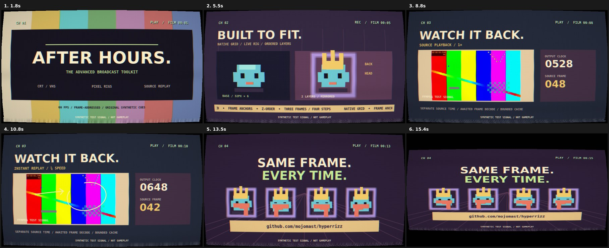

# Advanced broadcast lab · validation

**[Watch the film](https://github.com/mojomast/hyperrizz/raw/refs/heads/main/docs/examples/broadcast-lab.mp4)**
· [Contact sheet](examples/broadcast-contact-sheet.jpg)
· [Encoded-media report](examples/broadcast-verification.json)
· [Shader/seek report](examples/broadcast-seek-check.json)



## What this demonstrates

A 16-second, four-channel audiovisual example of the techniques extracted from
Hermagotchi Television: full-frame CRT/VHS, stateless shader noise, intensity
controls, tuning transitions, rigged/mirrored native-grid sprites, a cached-source
quarter-speed replay, a telestrator, OSD/tickers, sound cues and CRT power-off.

The assets are original synthetic fixtures, explicitly labelled on screen. This
is a technique demonstration, not footage of Hermagotchi or another live product.

## Measured output — 2026-11-08

| Property | Master | Committed preview |
| --- | --- | --- |
| Codec | H.264 + AAC | H.264 + AAC |
| Dimensions | 960×540 | 960×540 |
| Frame rate | 60fps | 60fps |
| Frames | 960 | 960 |
| Picture/container duration | 16.000s | 16.000s |
| Bytes | 3,781,927 | 3,481,480 |
| Integrated loudness | −17.95 LUFS | −17.98 LUFS |
| True peak | −5.20 dBTP | −5.20 dBTP |
| Full decode | Passed | Passed |

Audio is sparse, original broadcast sound effects rather than a full score. The
encoded peak ceiling was checked at ≤−1dBTP; no integrated-loudness target was imposed
on the isolated cue track. The preview report records the SHA-256 of the committed
MP4. A checksum match is checked when copying the verified export into this repo.

## Checks actually performed

- Materialized outside the installed skill and built with Node 22.19.0,
  HyperFrames 0.9.23 and its pinned dependencies.
- Build prepared **240 immutable 60fps frames** from a synthetic source clip, plus
  generated sound cues and a checksum manifest.
- Lint: **0 errors/warnings**. Full framework check: **passed**, no runtime errors,
  no layout/motion/craft/audio issues. Six software-WebGL `ReadPixels` performance
  warnings were recorded. Canvas had zero DOM text-contrast samples.
- **21 exact-pixel reverse and 21 shuffled matches**, covering every scene cut
  ±1 frame, both replay phases and power-off.
- Known animation changed pixels. Intensity 0, 0.7 and 1 produced different results.
  With all effects disabled, source/readback comparison had **zero changed bytes**.
- Tuning static and power-off each changed pixels independently.
- At output frames 600/601/603/604/648, quarter-speed replay used source frames
  **30/30/30/31/42**. Output time continued forward.
- The decoded-image cache stayed bounded at **12 entries**; seeking after eviction
  reproduced the same pixels. Out-of-range frame requests and pre-aborted requests
  were rejected.
- Six source stills were inspected. Six frames extracted from the actual master
  were inspected, including the rig, replay annotation, final lineup, collapse,
  thin-line stage and final black frame.
- Final master and preview passed full decode, duration/frame-count, audio and size
  verification before the render wrapper published them.
- Five timing/rig tests and three materializer tests passed. The materializer refuses
  existing destinations and paths inside the source tree without overwriting files.

## Reproduce

From the Hyperrizz checkout:

```sh
node scripts/create-broadcast-lab.mjs ../my-broadcast-lab
cd ../my-broadcast-lab
npm ci
npm run build
npm run lint
npm run check
npm run seek-check
npm run stills
npm run render
npm run verify
```

Choose a new destination. See the [lab guide](../templates/broadcast-lab/README.md)
for controls and the [kit API](../kits/broadcast/README.md) for reuse. The latest
materializer's naming/assembly safeguards were tested separately; all kit, scene,
runtime, fixture and effect-test source files matched the rendered project
byte-for-byte after those packaging refinements.

## Limits of this evidence

The shader tests ran in `HeadlessChrome/152.0.7977.30`; framework capture used Mesa
llvmpipe/ANGLE software rendering. No cross-GPU, cross-platform or physical-display
equivalence is claimed. No live product, original game asset import, signed-in
Hermes behavior, subjective sound-quality evaluation or full realtime listening
review was performed. The lab uses system fonts and generated media. The original
production's asset/quote/catalog coverage remains a project-specific check.
