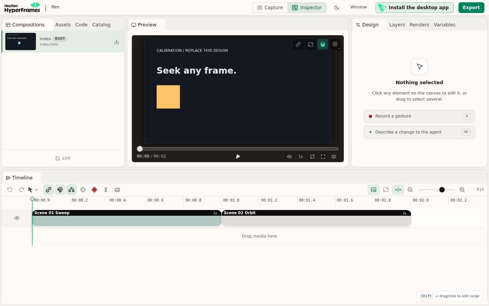

# Hyperrizz for Hermes

**Version 2.0.0 · agent-led production + native live review + optional full Studio.**

## What ships

One installable repository contains the Python plugin, three composable tools,
the complete production skill, the Desktop/Webapp pane, its backend routes, the
starter and the advanced broadcast kit. There is no separate hosted service and no
additional model credential. The normal Hermes agent does the creative work.

The default pane runs the **actual pinned HyperFrames player** in an opaque guest
frame. It is not a screen recording, a set of representative stills or an MP4.
Canvas/WebGL, deterministic scene callbacks, playback, scrubbing and audio run on
the viewing machine. A small bootstrap transfers large compositions through a
message bridge, avoiding Chromium's data-URL navigation limit.

## Architecture

```text
Hermes conversation ── 3 tools ── profile-scoped project + SQLite state
         ↑                              │
  addressed feedback                    ├─ bounded build/check/render worker
         │                              ├─ immutable review revisions
    Hyperrizz pane ── ctx.rest ── authenticated plugin API
         │                              │
         ├─ Review: native player ◀─────┘  chunked local film bytes
         └─ Full editor: input + JPEG ◀── owned loopback Studio + Chromium
```

No host credentials enter the film guest. The plugin uses namespace-relative
`ctx.rest` paths from the current SDK. It does not copy session grants, patch
Hermes UI, import application chunks or manipulate the conversation DOM.

The `post_tool_call` observer binds new projects to the host-supplied session ID.
The pane follows the focused conversation and sends feedback through the documented
`host.composer.submit(session, text)` API. If no mounted conversation accepts a
submission, the note stays saved and the UI explains that it was not sent.

## Full Studio



Studio is launched only on demand. The plugin owns its local server, browser and
profile, uses one bounded screenshot path, and forwards input through Hermes's
authenticated API. There is no user-facing loopback URL to break on a remote host.
The internal control relay binds loopback and requires a per-session token; that
token is not returned to the pane or model. It rejects browser-origin requests and
redirects. A frame response is capped at 512 KiB, including base64/JSON overhead;
input is capped at 16 KiB. Image quality is reduced within a bounded retry budget.

The Studio relay is for interaction, not final color or motion QA, and carries no
audio. Use the native Review player to audition sound. Studio's own feature support
still applies: a canvas scene does not become independently editable DOM text.
The full editor retains its local capabilities; external services requiring their
own accounts are not configured by this plugin.

## Data and recovery

All mutable data lives in Hermes's profile-aware plugin-data directory:

| Directory | Contents |
| --- | --- |
| `projects/` | Editable source, installed pinned dependencies, derived build |
| `revisions/` | Immutable source/build review checkpoints |
| `backups/` | Source preserved before an explicit restore |
| `jobs/` | Worker logs; status and cancellation are in SQLite |
| `exports/` | Verified, versioned MP4s and the latest published report |
| `editors/` | Recoverable Studio working copies and private session metadata |
| `preview-packages/` | Cached self-contained live-review documents |
| `runtime-home/` | Isolated npm cache and provisioned Chromium |

Source writes require the hash returned by the last read. Studio checkpoints set
an explicit source-divergence flag; source rebuilding is blocked until reconciled
or restored. A failed build does not replace a published review revision. An export
is published only after its verification passes and source/build freshness matches.

The review package supports local, bundled source assets: at most 32 MiB before
packaging and 48 MiB assembled. Use review proxies for larger media; original media
can remain in the production workflow. The first install needs npm/Chromium network
access. Subsequent local project work needs no generation service. HyperFrames
telemetry is disabled in plugin-managed children.

Jobs and Studio share a profile production lease. Linux processes use nice 19 and
two CPU cores; the starter render wrapper also bounds workers/FFmpeg and owns the
shared render lock. Cancelling a job terminates its own process group. Studio
expires after two minutes without pane activity, preserving its working files.
Project code and build scripts execute locally; the browser guest is not an OS
sandbox for those scripts. Running Chromium as root needs its documented no-sandbox
launch flag; normal-user launches retain Chromium's sandbox.

## Installation and platform scope

```sh
hermes plugins install mojomast/hyperrizz
hermes plugins enable hyperrizz
```

Enable the pane in **Capabilities → Plugins**. A remote backend needs the agent
half on the server and the Desktop half on the client. Unified local installs copy
the Desktop half automatically. The classic dashboard has backend routes but no
separate dashboard tab: the UI is the Desktop/Webapp pane.

Requires Hermes 0.23.0+, Node 22+, Python 3.11+ and FFmpeg. Linux is tested. The
manifest also permits macOS, whose runtime path is implemented but not tested.
Windows is not declared. Projects survive updates because state is outside the
installed checkout. Reopen the pane after updating; refresh the desktop copy through
Capabilities when needed.

## Validation scope

Machine-readable summary: [Hermes plugin evidence](examples/hermes-plugin-evidence.json).

- Real Hermes `plugins doctor --ci`: discovery/import, three tools and one hook pass.
- Real Hermes `plugins validate --install-deps`: manifest, declared registrations,
  security scan, public imports and Desktop SDK surface pass.
- Real Hermes ASGI application, including isolated `plugins.isolation: host`: anonymous requests rejected (401), authenticated
  plugin requests succeed (200), disabling the plugin closes the route (404).
  A complete broadcast preview package, a 683 KB base64 chunk and a frame-note write
  also pass through the real isolated host transport.
- Seventeen Python behavior tests cover registration, JSON results, profile isolation,
  file confinement, stale/conflicting edits, restore backups, revision-bound notes,
  session binding, minimal child environment, asset failures, editor reconciliation
  ownership-aware stale render-lock cleanup, expired-editor recovery, modified-build
  rejection and exclusive project edits.
- Real Chromium with upstream player in an opaque sandbox: seek, play, pause and
  different-time pixel changes pass with no page errors or blocked-network errors.
- Shipping pane bundle + SDK test harness + real REST backend: a 16-second broadcast
  project loads, plays and scrubs; feedback is persisted at frame 48 and addressed to
  the correct session; switching chats does not leak the previous selection.
- Real full HyperFrames Studio launches and paints the project and timeline through
  the bounded relay. Pointer/keyboard/paste changed the document title through its
  real Code editor; saving and closing produced revision 2 with the source-rebuild
  interlock set. Unchanged editor sessions did not create a new revision.
- Real-process cancellation killed the owned process group and released its dead
  project render lock. An intentionally failing build preserved its prior preview.
- Feedback → source changes → two successful preview revisions → complete verified
  MP4: **16.000s, 960×540, 60fps, 960 frames, 3,781,435 bytes**, H.264/AAC,
  **−17.95 LUFS / −5.20 dBTP**, full decode passed. This is an integration fixture,
  not a claim of a new standalone artistic production.

Hermes source used for backend validation:
`0b82ddc96c39449d30763d0fdd50ac22fed0fb31`. HyperFrames: `0.9.23`.
The native Desktop window and an actual provider-backed Hermes model turn are not
claimed as tested. Composer acceptance uses the SDK harness; artistic quality and
subjective listening are not implied by passing software checks.

## Development checks

```sh
python3 scripts/check-package.py
python3 -m pytest tests/test_plugin.py -q
python3 tests/test_verifier.py
npm --prefix tests ci
npm --prefix tests test
hermes plugins doctor . --ci
hermes plugins validate . --install-deps
```

The optional browser tests need a provisioned project/Chromium and run sequentially:
`tests/preview-browser.mjs` tests the player; `tests/pane-browser.mjs` tests the pane.
`tests/hermes-host.py` requires a Hermes checkout and an isolated test home.
The Node test dependencies live under `tests/`, so normal plugin installation does
not prompt to install React or the test harness. Project build dependencies are
installed into each project's own directory by its first build.
Run it with that checkout's selected Hermes runtime interpreter; mixing a Python
3.11 executable with dependencies resolved for Python 3.14 cannot load native wheels.

## What we learned from the references

[hermes-plugin-dev](https://github.com/mojomast/hermes-plugin-dev) supplied the
manifest/registration, lean-schema, profile-storage, SDK transport, validation and
boundary contracts. The implementation was checked against current Hermes source.

[hermes-stitchslop](https://github.com/mojomast/hermes-stitchslop) demonstrated why
remote panes should not assume localhost means the backend, why one capture path
avoids flicker, and why processes and input need explicit ownership. Hyperrizz uses
those lessons for the optional Studio handoff. Review itself stays native so it
can play sound and scrub without a server-side capture loop. No Stitchslop source
or app assets are bundled.
